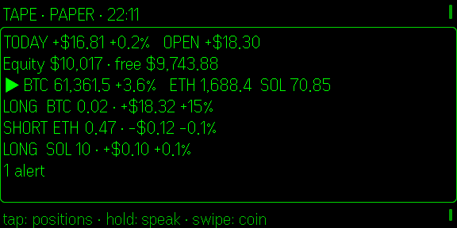
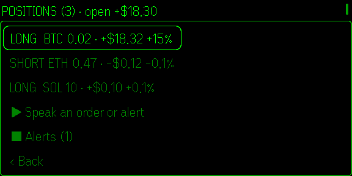
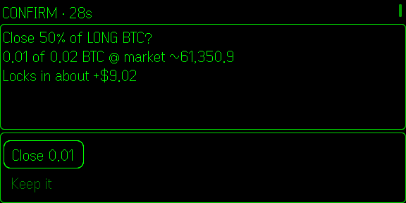
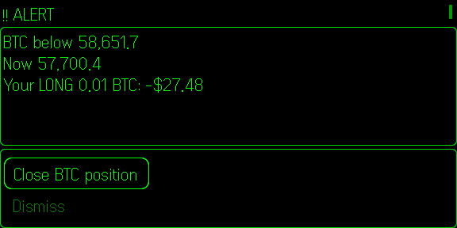

# Tape: trading at a glance, for Even G2

Tape puts your trading session on Even G2 smart glasses: **today's PnL, open positions and live prices** on one screen, **price and PnL alerts** that take over the display when they fire, and **voice orders you confirm with one tap**:

> *"Short $200 of SOL"* → `SELL 2.8 SOL · $198.52 · Market · now 70.9 · Opens a SHORT` → tap **Sell 2.8 SOL** → filled.

It runs on **Bybit testnet**, **Bybit demo trading** or a built-in **paper account** on live public prices. Mainnet keys are not supported, by design.

**For users:** install Tape from Even Hub, open it in the Even Realities app, and tap **Start with paper money**: one tap, no form, no email. Or paste a Bybit testnet key to trade your own test account.

Built for the DoraHacks *Heads Up: Even Realities* hackathon, **Track 03 · Exchanges & Stocks**.

| Home | Positions | Confirm | Alert |
|---|---|---|---|
|  |  |  |  |

*Real captures from the official Even Hub simulator (576 × 288, monochrome green), paper account on live Bybit prices.*

## Why

A trader in a session looks at three things over and over: PnL, positions and one or two prices. That check takes a phone unlock, an app switch and a scroll, many times an hour, often while doing something else. And acting fast ("get me out of half my BTC") means more taps on a small screen at the worst moment. Tape makes the check a glance and the action a short phrase plus one tap.

## What it does

**Read**
- **Home:** `TODAY +$16.81 +0.2% · OPEN +$18.30`, equity and free margin, the focused coin with 24 h change, the top 3 positions and counts of orders and alerts. Updates live every 3 s, with no page rebuild and no flicker. **Swipe** to change the focused coin.
- **Positions:** one line each (side, size, PnL, % on margin). Tap one for entry, mark and liquidation price, with **Close** and **Close half** buttons.
- **Alerts:** price (`BTC below 90k`, `ETH drops 5%`) and PnL (`PnL below -$200`). When one fires, the glasses show it at once with a one-tap **Close BTC position** if you hold that coin. An alert never interrupts a confirm card or someone speaking; it waits until they finish.

**Write**: hold the touchpad (or the R1 ring) and talk:

| Say | You get |
|---|---|
| "Buy 0.01 BTC" · "Long $500 of ETH" · "Short 2 SOL at 150" | market or limit order card with size, notional, price and what it does to your position |
| "Close my BTC" · "Close half of ETH" · "Take profit on 25% of SOL" | reduce-only close card showing the PnL you lock in |
| "Close everything" / "Flatten" | danger card: **Cancel is the first item**, so a stray tap does nothing |
| "Move 500 from funding to trading" (or "spot to margin") | wallet transfer card |
| "Cancel my orders" | cancel-all card |
| "Alert me if Bitcoin drops below 90k" · "Alert if PnL is below minus 200" | alert set immediately (no trade, no card) |
| "What's SOL at?" · "How am I doing?" · "Watch Solana" | answer on the glasses |

## Safety

Money safety is the core of the design, not an afterthought:

- **Nothing trades without a tap on the glasses.** Every order, close, transfer and cancel becomes a confirm card first.
- **Cards expire** after 30 s (countdown in the header). Only the newest card is valid, and each runs at most once.
- **Re-checked at send time:** a market card is refused if the price moved over 1% since it was shown, or if trading was switched off in the meantime.
- **Hard limits:** a per-order cap (`MAX_ORDER_USD`, default $2,500). Users can lower it in the app but never raise it. Limit prices more than 25% from the market are refused as probable mishearings.
- **Rules, not AI, decide orders.** Speech-to-text (Whisper) turns audio into words; a deterministic parser turns the words into an order. No language model ever picks a side, a size or a coin. If anything is unclear, Tape asks instead of guessing: "Buy bitcoin" (no size) gets examples, not a trade. "Close all my ETH" closes ETH, never everything.
- **Read-only mode** (phone switch or `READ_ONLY=1`): prices, PnL and alerts only.
- **No mainnet, no custody, no withdrawals.** Bybit endpoints are hard-coded to testnet and demo. Keys stay in the server `.env`, never in the app, and need only Contract and Transfer permissions.
- **Not financial advice.** Tape shows your own data and does what you confirm.

## Architecture

```
G2 glasses ⇄ BLE ⇄ Even Realities app (WebView: Tape app, TypeScript)
                              │  HTTPS + SSE (bearer token)
                              ▼
                     Tape server (Node 22, Fastify)
             ┌────────────────┼──────────────────────────┐
     Bybit V5 REST       paper engine            speech-to-text
   (testnet / demo,   (live prices: Bybit →    (any OpenAI-compatible
    HMAC-signed)       Binance → simulated)     Whisper, e.g. speaches)
```

- `server/src/commands.ts`: speech → intent parser (numbers in words, "$500", "90k", coin names and common mishearings).
- `server/src/desk.ts`: live snapshot loop, alert checks, confirm cards and the safety checks.
- `server/src/exchange/bybit.ts`: Bybit V5 (orders, positions, wallet balance, closed PnL, cancel-all, inter-account transfer).
- `server/src/exchange/paper.ts`: cross-margin USDT-perp simulator (fees, average entry, flips, resting limit orders, transfers).
- `server/src/accounts.ts` + `server/src/lib/db.ts`: hosted mode (accounts, hashed tokens, AES-256-GCM-encrypted exchange keys in SQLite, idle unloading, export and delete).
- `app/src/glasses/controller.ts`: every glasses screen and input; `app/src/phone/ui.ts`: the phone companion (start screen, live mirror, account, alerts, safety settings).

### Two ways to run the server

| | `TAPE_MODE=self` (default) | `TAPE_MODE=hosted` |
|---|---|---|
| Who | you, on your own machine | a public service for anyone |
| Sign-in | one shared `APP_TOKEN` | one tap in the app (paper) or paste a Bybit testnet/demo key; per-device token, stored hashed |
| Exchange | set in `server/.env` | each user picks theirs; keys encrypted at rest with `DATA_KEY`; keys that can withdraw are refused |
| Data | JSON files in `DATA_DIR` | SQLite (`DATA_DIR/tape.db`, owner-only), export and delete in the app, inactive accounts erased after 180 days |
| Deploy | `docker compose up -d` | [`deploy/README.md`](deploy/README.md): Caddy + HTTPS, backups, [`PRIVACY.md`](PRIVACY.md) template |

## Run it locally (5 minutes, no accounts)

Requirements: Node 22+. Optional: Podman or Docker for speech-to-text.

```bash
# 1. Server (paper account on live prices)
cd server
cp .env.example .env
sed -i "s/^APP_TOKEN=.*/APP_TOKEN=$(openssl rand -hex 24)/" .env
npm install
npm run dev                     # http://localhost:8791

# 2. Speech-to-text (optional, for voice)
docker run -d --name tape-whisper -p 8000:8000 ghcr.io/speaches-ai/speaches:latest-cpu

# 3. Glasses app
cd ../app
npm install
npm run dev                     # http://localhost:5174, the phone UI with a glasses emulator

# 4. Even Hub simulator (the real G2 renderer)
npx evenhub-simulator http://localhost:5174
```

Open <http://localhost:5174>, paste `http://localhost:8791` and your `APP_TOKEN` under **Server**, and click **Connect**. Use the on-screen touchpad, or the keyboard (↑ ↓ swipe, Enter tap, Esc double-tap, hold Space to talk), or type commands. In paper mode, **Demo controls** move a price ±2% so you can watch an alert fire.

### Use your Bybit testnet account

1. Sign up at <https://testnet.bybit.com>, then use **Assets → Request test coins**.
2. **API → Create new key → System-generated**, read-write, with **Contracts: Orders + Positions** and **Wallet: Account transfer** permissions.
3. In `server/.env`: `EXCHANGE=bybit`, `BYBIT_ENV=testnet`, `BYBIT_API_KEY=…`, `BYBIT_API_SECRET=…`, then restart.

Prefer real prices with fake money? Use Bybit **demo trading** (`BYBIT_ENV=demo`, keys made in demo mode). Demo trading has no funding wallet, so transfers are disabled there.

### Deploy

Public service (recommended): follow [`deploy/README.md`](deploy/README.md): `TAPE_MODE=hosted`, Caddy for HTTPS, daily backups.

Just for yourself:

```bash
cp server/.env.example server/.env   # set APP_TOKEN, exchange keys
docker compose up -d                 # tape (port 8791) + local Whisper
```

Put it behind HTTPS (Caddy, Cloudflare Tunnel). Then build the Even Hub package:

```bash
cd app
echo "VITE_SERVER_URL=https://tape.example.com" > .env.production
npm run pack                         # → tape.ehpk, whitelisting exactly that origin
```

`npm run pack` refuses to build if a token would be embedded, or if the server URL is not https.

## Tests

```bash
cd server && npm test   # 77 tests: parser, paper engine, Bybit signing/mapping, confirm/expiry/caps, alerts,
                        # outages (no stale fills), hosted accounts (isolation, encryption, key checks, delete, limits)
cd app && npm test      # every glasses page validated with the Even Hub SDK validator, 63-byte list items, full flows
```

Also verified by hand:
- the glasses UI in the official Even Hub simulator;
- voice end to end: spoken commands (synthesized speech) → 16 kHz PCM → Whisper small → parser, 8 of 8 correct;
- hosted mode in headless Chrome: one-tap sign-up → order → confirm → fill → reload → delete account;
- the production build (`npm start`) surviving a restart with accounts, positions and alerts intact;
- a real network outage: the app answers in under 3 s, shows "No live data", pauses new orders and never falls back to made-up prices.

## Status and honest limits

- **Tested:** paper mode on live Bybit public prices, the full glasses UI in the Even Hub simulator, voice through local Whisper, hosted sign-up / trade / delete in a browser, restart persistence, outage behaviour, the self-hosted Docker image.
- **Not yet run against a real Bybit testnet account.** Request signing, response mapping and the key-permission check are unit-tested against Bybit's documented V5 formats with a fake server. The withdraw-permission check reads `GET /v5/user/query-api`; if Bybit names that permission differently than expected, the check would miss it. Verify this with a real key before inviting users.
- **G2 hardware:** built and tested in the simulator only. Long-press-to-talk depends on the touchpad or ring delivering long-press events; "▶ Speak" in the Positions list works with a plain tap as a fallback.
- **Scale:** one process per SQLite file (a few hundred users per small VM). Moving to Postgres means swapping `server/src/lib/db.ts`.
- **Account recovery:** accounts have no email or password, by design. A lost device means starting a new paper account or reconnecting the Bybit key.

## Prior work and reuse

Everything in this repository was written during the hackathon (from Nov 26, 2026). A few low-level helpers were adapted from the same author's other hackathon project, **Glance** (Telegram on G2): the Even Hub bridge wrapper (`app/src/lib/glasses.ts`), the microphone recorder with voice-activity detection (`app/src/lib/recorder.ts`), text fitting for the G2 font (`app/src/lib/text.ts`), the Whisper client (`server/src/stt.ts`), the encrypted SQLite store (`server/src/lib/db.ts`), the JSON store and HTTP retry helpers, the manifest generator and the deploy kit layout. Open-source dependencies: Fastify, Zod, Pino, Vite, Vitest and the Even Hub SDK, CLI and simulator.

## Feature requests

1. **Even Hub: background alerts.** Let an app push one short line to the glasses while another app is in front, or the screen is off. A price or PnL alert is only useful when it reaches you.
2. **Even Hub: on-device or SDK speech-to-text.** Every app ships audio to its own Whisper. A built-in, short-command recognizer would cut latency and cost.
3. **Even Hub: glyph coverage API.** The G2 font lacks common symbols (e.g. `▸`, all emoji). Publish the glyph list, or expose a "can render" check.
4. **Bybit: scoped, expiring "glasses" API keys.** For example: trade only, max notional per order, auto-expiry. That would make wearable trading safer than sharing a full key with a server.
5. **Bybit: a fill and alert webhook or push channel for small clients** without keeping a private WebSocket open on a phone.

## License

MIT
